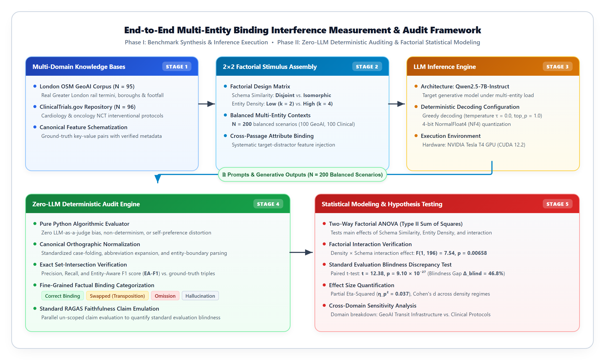
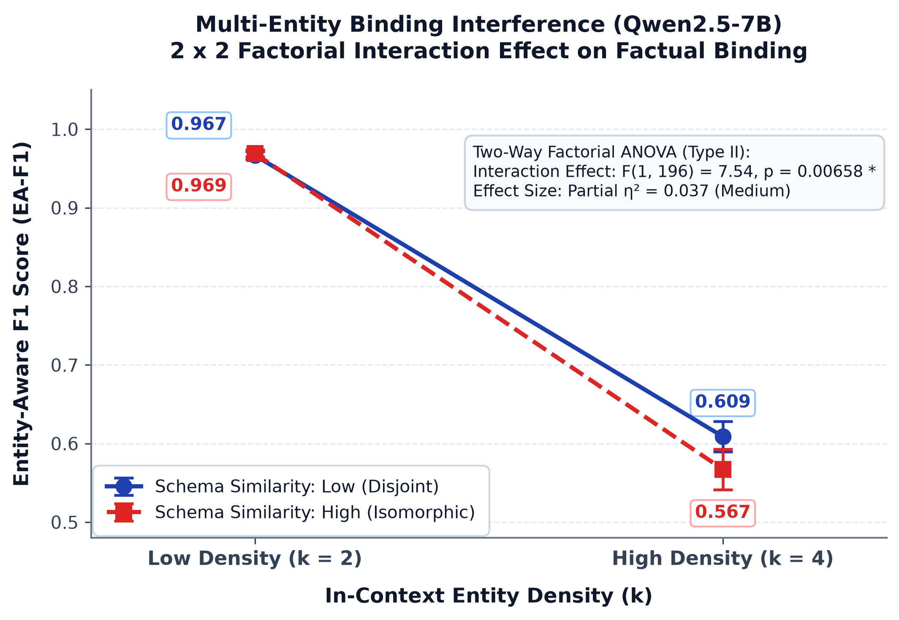
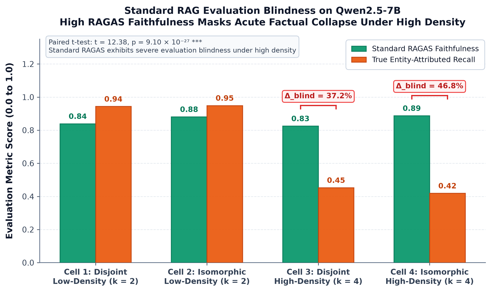
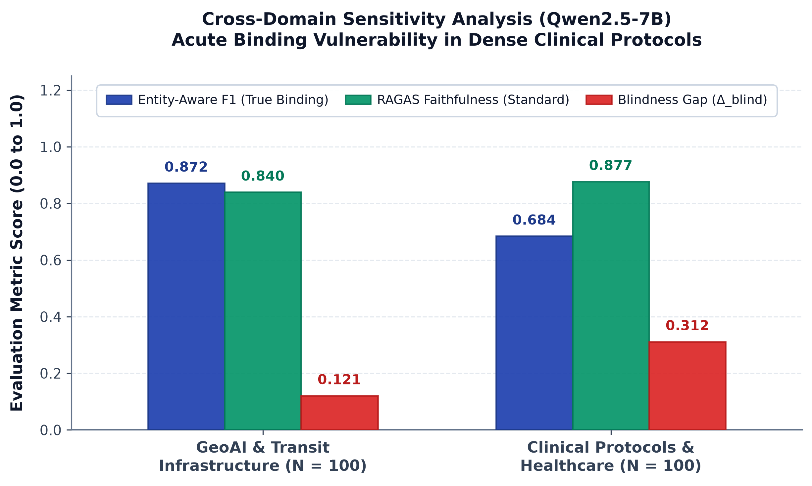

<div align="center">

# Multi-Entity Interference (MEI) in Retrieval-Augmented Language Models

**Measurement Framework, Mechanistic Analysis, and Software Mitigations**

[](https://github.com/sayem088/Multi_Entity_Interference_in_Retrieval-Augmented_LLMs/actions/workflows/ci.yml)
[](https://www.python.org/downloads/)
[](LICENSE)
[](https://colab.research.google.com/github/sayem088/Multi_Entity_Interference_in_Retrieval-Augmented_LLMs/blob/main/notebooks/reproduce_qwen2_5_7b.ipynb)

</div>

---

## Overview

Retrieval-Augmented Generation (RAG) systems frequently retrieve multiple passages describing sibling entities from the same ontological class (e.g., adjacent hospitals, urban transit hubs, or parallel oncology protocols). When these co-occurring passages exhibit **high schema similarity** under **multi-entity load**, autoregressive language models suffer from **Multi-Entity Binding Interference (MEI)**: transposing attributes across sibling entities or collapsing structured extraction while maintaining fluent prose.

Crucially, widely adopted reference-free evaluators (such as **RAGAS Faithfulness**) verify claim-to-context entailment across the entire un-scoped context window. As a result, they remain mathematically blind to cross-entity attribute swaps and omissions, certifying corrupted outputs as faithful (**The Evaluation Blindness Paradox**).

This repository provides the official benchmark suite, deterministic zero-LLM auditing engine, statistical analysis scripts, and reproducible evaluation outputs supporting this research.

### Key Contributions
- **Formal $2 \times 2$ Factorial Benchmark ($N = 200$):** Systematically crosses *Schema Similarity* (Disjoint vs. Isomorphic) with *In-Context Entity Density* (Low $k = 2$ vs. High-Density) across real-world **GeoAI Spatial Infrastructure (OpenStreetMap)** and **Clinical Trial Protocols (ClinicalTrials.gov)**.
- **Deterministic Zero-LLM Audit Engine (`src/mei/scoring/`):** Pure Python tuple-extraction and orthographic normalization pipeline computing Entity-Attributed F1 ($EA\text{-}F1$), Binding Error Rate ($BER_k$), and the Evaluation Blindness Gap ($\Delta_{\text{blind}}$) with zero stochastic LLM-judge bias.
- **Empirical Proof of Evaluation Blindness:** Demonstrates a **46.8% Evaluation Blindness Gap** ($\Delta_{\text{blind}} = 0.468$, paired $t = 12.38, p = 9.10 \times 10^{-27}$) in high-density isomorphic contexts where RAGAS scores $0.888$ despite true entity recall collapsing to $0.419$.
- **Inferential Statistical Validation:** Two-Way Factorial ANOVA (Type II Sum of Squares) confirms a significant Density $\times$ Schema Similarity interaction on evaluation blindness ($F(1, 196) = 7.54, p = 0.00658, \eta_p^2 = 0.037$).

---

## Measurement & Auditing Architecture

<div align="center">
  
</div>

The experimental framework executes across five reproducible stages:
1. **Multi-Domain Knowledge Ingestion:** Curates real records via the OpenStreetMap / Nominatim API (Greater London GeoAI infrastructure) and the ClinicalTrials.gov REST API v2 (Phase II/III interventional trials).
2. **$2 \times 2$ Factorial Stimulus Synthesis:** Packages $N = 200$ balanced prompts (`100 GeoAI`, `100 Healthcare`; `50 per factorial cell`) paired with canonical ground-truth entity-attribute dictionaries.
3. **Deterministic Model Inference:** Evaluates `Qwen2.5-7B-Instruct` (4-bit NF4 quantization, greedy decoding $\tau = 0.0$) to eliminate sampling variance.
4. **Zero-LLM Deterministic Auditing:** Categorizes every generated claim into *Correct Binding*, *Transposition/Swap*, *Omission*, or *Hallucination* without neural judge models.
5. **Statistical Modeling:** Computes Two-Way Factorial ANOVA, partial $\eta_p^2$ effect sizes, paired $t$-tests, and publication graphics directly from audited CSV outputs.

---

## Empirical Findings (`Qwen2.5-7B-Instruct`, $N = 200$)

### 1. Factorial Cell Performance & Evaluation Blindness

| Factorial Cell | Schema Similarity ($S_{\text{schema}}$) | Entity Density | $N$ | Exact Acc | $EA\text{-Recall}$ | $EA\text{-}F1$ $\uparrow$ | RAGAS Faithfulness | Blindness Gap ($\Delta_{\text{blind}}$) |
| :--- | :---: | :---: | :---: | :---: | :---: | :---: | :---: | :---: |
| **Cell 1:** Disjoint Low-Density | Low | Low ($k=2$) | 50 | 0.938 | 0.944 | **0.967** | 0.839 | **0.016** (1.6%) |
| **Cell 2:** Isomorphic Low-Density | High | Low ($k=2$) | 50 | 0.942 | 0.949 | **0.969** | 0.881 | **0.008** (0.8%) |
| **Cell 3:** Disjoint High-Density | Low | High | 50 | 0.451 | 0.453 | **0.609** | 0.825 | **0.372** (37.2%) |
| **Cell 4:** Isomorphic High-Density | High | High | 50 | 0.418 | 0.419 | **0.567** | **0.888** | **0.468 (46.8%)** |

> **Statistical Confirmation (Two-Way Factorial ANOVA, Type II SS):**  
> - **Blindness Gap ($\Delta_{\text{blind}}$):** Main effect of Entity Density $F(1, 196) = 458.11, p = 3.46 \times 10^{-53}, \eta_p^2 = 0.700$; Main effect of Schema Similarity $F(1, 196) = 5.21, p = 0.0235, \eta_p^2 = 0.026$; **Interaction Effect $F(1, 196) = 7.54, p = 0.00658, \eta_p^2 = 0.037$**.  
> - **Paired $t$-Test ($H_a: \Delta_{\text{blind}} > 0$):** $\bar{\Delta} = 0.2162 \pm 0.2470$, $t = 12.38, p = 9.10 \times 10^{-27}$.  
> - **Entity-Aware F1 ($EA\text{-}F1$):** Entity Density $F(1, 196) = 536.29, p = 5.30 \times 10^{-58}, \eta_p^2 = 0.732$.

<div align="center">
  
  
</div>

### 2. Cross-Domain Vulnerability: GeoAI Infrastructure vs. Clinical Trials

| Knowledge Domain | Scenarios ($N$) | $EA\text{-}F1$ $\uparrow$ | RAGAS Faithfulness | Blindness Gap ($\Delta_{\text{blind}}$) | Mean Latency |
| :--- | :---: | :---: | :---: | :---: | :---: |
| **GeoAI Spatial Infrastructure** (OpenStreetMap) | 100 | **0.872** | 0.840 | **0.121** (12.1%) | 20.92s |
| **Clinical Trial Protocols** (ClinicalTrials.gov) | 100 | **0.684** | 0.877 | **0.312** (31.2%) | 26.28s |

Clinical trial protocols contain dense, homogeneous numerical identifiers (trial phases, enrollment targets, dosage intervals), producing a $2.58\times$ larger Blindness Gap compared to geospatial transit records anchored by distinct proper nouns.

<div align="center">
  
</div>

---

## Diagnostic Metrics & Auditing API

We formalize three deterministic metrics over context $C = \{e_1, \dots, e_k\}$ and ground-truth attribute sets $A^*(e_i)$:

1. **Entity-Attributed F1 ($EA\text{-}F1$):** Micro-averaged precision and recall over exact `(entity, attribute, value)` triples.
2. **Binding Error Rate ($BER_k$):** Isolates cross-entity transpositions (values present in $C$ assigned to the wrong entity $e_j \neq e_i$) from ungrounded hallucinations.
3. **Evaluation Blindness Gap ($\Delta_{\text{blind}}$):**
   $$\Delta_{\text{blind}}(Y, C) = \max\big(0,\; F_{\text{RAGAS}}(Y, C) - EA\text{-Recall}(Y, C)\big)$$

```python
from mei.scoring import compute_ber_k, compute_ea_f1, compute_ragas_faithfulness

ber = compute_ber_k(model_output, ground_truth)
ea = compute_ea_f1(model_output, ground_truth)
ragas = compute_ragas_faithfulness(model_output, ground_truth)

blindness_gap = max(0.0, ragas["ragas_faithfulness"] - ea["ea_recall"])
```

---

## Software Architectural Mitigations

To prevent Multi-Entity Binding Interference in production RAG pipelines without fine-tuning model weights, this research formulates three system-level architectural patterns:

1. **Schema-Aware Delimited Framing:** Encapsulates sibling passages inside machine-readable boundary tags (`<entity id="e1">...</entity>`) with entity-scoped key namespaces (`e1.dosage`), separating self-attention key subspaces.
2. **Entity-Isolated Parallel Decoding:** Decomposes multi-entity extraction into $k$ parallel single-entity calls ($k = 1$), eliminating cross-entity attention dispersion by construction ($BER_1 \equiv 0$).
3. **Constrained Grammar Logit Masking:** Enforces finite-state schema completion over JSON output tokens to prevent silent attribute omissions under high context load.

---

## Quickstart & Reproducibility

### 1. Installation
```bash
git clone https://github.com/sayem088/Multi_Entity_Interference_in_Retrieval-Augmented_LLMs.git
cd Multi_Entity_Interference_in_Retrieval-Augmented_LLMs
pip install -e ".[dev]"
```

### 2. Verify Unit Tests & Statistical Benchmark
Run the deterministic metric unit tests and reproduce every summary table, ANOVA $F$-statistic, and paired $t$-test directly from the audited dataset:
```bash
pytest -v
python experiments/qwen2_5_7b/reproduce_analysis.py
```

### 3. Execute Full Experimental Pipeline
For GPU inference (`Qwen2.5-7B-Instruct` with `bitsandbytes` NF4), install GPU extras (`pip install -e ".[gpu]"`) and execute the four-stage pipeline:
```bash
python scripts/01_build_stimulus_set.py
python scripts/02_run_generation.py
python scripts/03_run_scoring.py
python scripts/04_run_analysis.py
```

---

## Repository Structure

```text
├── .github/workflows/ci.yml              # Automated pytest & benchmark verification CI
├── assets/                               # Publication-ready architecture & result figures
├── configs/                              # YAML definitions for domains, model, & 2x2 design
├── data/processed/                       # Curated GeoAI, Healthcare, & Wikipedia scenarios
├── experiments/qwen2_5_7b/               # Audited N=200 CSV, ANOVA script, & LaTeX tables
│   ├── reproduce_analysis.py             # Reproduces Table 1, Table 2, ANOVA, & t-test
│   ├── summary_qwen_7b.csv               # Complete 200-scenario audited metrics
│   └── tables/                           # IEEEtran booktabs LaTeX deliverables
├── notebooks/
│   └── reproduce_qwen2_5_7b.ipynb        # End-to-end Google Colab reproduction notebook
├── scripts/                              # Modular 4-stage CLI execution scripts
├── src/mei/                              # Core Python package (`mei`)
│   ├── retrieval/                        # OSM GeoAI, ClinicalTrials.gov, & Wiki clients
│   ├── schema/                           # Jaccard schema similarity computation
│   ├── stimulus/                         # Controlled 2x2 factorial prompt builder
│   ├── generation/                       # Quantized LLM inference & prompt templates
│   ├── scoring/                          # Zero-LLM BER_k, EA-F1, & RAGAS wrapper
│   └── analysis/                         # Statistical summary & discriminant validity
├── tests/                                # Automated unit test suite
├── LICENSE                               # MIT License
└── pyproject.toml                        # Package build configuration
```

---

## License

This project is released under the [MIT License](LICENSE).
